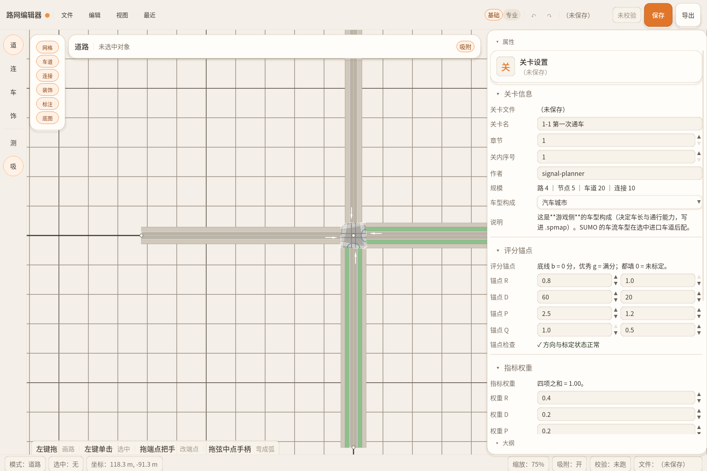

# 路网编辑器（Road Network Editor）

一个面向**微观交通仿真**的 2D 路网编辑器：在画布上画出道路、路口、信号配时和交通需求，
导出成游戏可用的格式，或导出成 **SUMO** 能直接跑的 `net.xml` / `rou.xml` / `sumocfg`。

> 定位：**简单路网不必再进 netedit 二次编辑**，画完就能跑仿真、看延误。
> 复杂路网仍然推荐用 SUMO 官方工具链 —— 差距见下方 [「还不能代替 SUMO 的地方」](#还不能代替-sumo-的地方)。



---

## 目录

- [它是什么 / 不是什么](#它是什么--不是什么)
- [环境要求](#环境要求)
- [快速开始](#快速开始)
- [功能清单](#功能清单)
- [还不能代替 SUMO 的地方](#还不能代替-sumo-的地方)
- [代码结构](#代码结构)
- [数据格式](#数据格式)
- [二次开发](#二次开发)
- [当前状态](#当前状态)

---

## 它是什么 / 不是什么

**是**：

- 一个**画路网**的工具：道路横断面、路口、转向、信号配时、交通需求、检测设施、公交线路
- 一个**格式转换器**：`.spmap`（自有格式）→ Shapefile / SUMO `net.xml` + `tll.xml` + `rou.xml` + `add.xml` + `sumocfg`
- 一个**带校验的编辑器**：导不出来时告诉你哪一条具体错了，点一下能定位到画布上的那个对象

**不是**：

- **不是仿真器本身**。它不跑车辆跟驰、不算延误。要看车辆怎么走、堵多久，靠导出的 SUMO 产物（内置「一键试跑」调起 SUMO 拿统计）
- **不是 SUMO 的 GUI 替代品**。没有 netedit 的路口形状编辑、多边形/POI、OSM 导入
- **不是 GIS 工具**。底图只能当描图垫，不做坐标投影计算（导出 SHP 时才做 UTM/WGS84 换算）

---

## 环境要求

### 运行（只是打开软件用）

| 软件 | 版本 | 必须 | 说明 |
| --- | --- | --- | --- |
| **Godot Engine（.NET 版）** | **4.7.2** | ✅ | **必须是 mono / .NET 版本**，标准版无法运行 C# 桥接层。从 [godotengine.org](https://godotengine.org/download) 下载 `.NET` 那一栏 |
| **.NET SDK** | **8.0 或更高** | ✅ | 工程 `TargetFramework = net8.0`。实测用 SDK 10.0.401 |
| **Eclipse SUMO** | 1.28.0（1.20+ 应该都行） | ⬜ 可选 | 只有导出 SUMO 格式、专业模式和「一键试跑」需要。装完把 `bin` 目录加进 PATH 或 `SUMO_HOME`，编辑器会自动探测 |

### 二次开发

| 软件 | 版本 | 用途 |
| --- | --- | --- |
| **Godot Engine（.NET 版）** | **4.7.2** | 打开 `Editor/project.godot` 改界面与交互（GDScript） |
| **.NET SDK** | **8.0+**（推荐 10.x） | 编 `SimCore` / `MapExport` 与跑单测 |
| **IDE** | VS Code + C# Dev Kit / JetBrains Rider / Visual Studio 2022 | 改 C# 代码 |
| Python | 3.8+ | 仅 `Tools/sumo_preview.py`（把 SUMO 结果画成图）需要 |

> **项目已实测平台：Windows 10/11。** macOS / Linux 理论可行（Godot 与 .NET 都跨平台），但**没有验证过**，
> 尤其是导出 exe、字体加载、`ProjectSettings.globalize_path` 的路径处理。

---

## 快速开始

### 1. 编译

```bash
# 仓库根目录
dotnet build SignalPlanner.sln
```

这一步编 4 个 C# 工程：`SimCore`（仿真核）、`SimCore.Tests`、`MapExport`（导出库）、`MapExport.Tests`。

### 2. 打开编辑器

用 **Godot .NET 版**打开 `Editor/project.godot`，按 `F5`。

或者命令行：

```bash
# 把路径换成你的 Godot .NET 版可执行文件
"C:/Godot/Godot_v4.7.2-stable_mono_win64.exe" --path Editor
```

> 首次打开 Godot 会导入资源（字体约 17 MB），要等一会儿。
> `Editor` 工程会引用 `../SimCore` 和 `../Tools/MapExport`，**必须保持仓库的目录结构**。

### 3. 跑测试

```bash
dotnet test SimCore.Tests/SimCore.Tests.csproj              # 330 条
dotnet test Tools/MapExport.Tests/MapExport.Tests.csproj    # 64 条
```

> 测试会读 `docs/examples/01-1-first-crossing.spmap`（唯一测试关卡资产），**别删**。

### 4. 试一次完整流程

1. 打开编辑器 → `文件 → 打开…` → 选 `docs/examples/01-1-first-crossing.spmap`
2. 按 `2` 进连接模式，点一下中间的路口，按 `G` 生成转向
3. `Ctrl+E` 打开导出窗口，勾 `SUMO .net.xml` + `SUMO .rou.xml` + `SUMO .sumocfg`
4. 点「导出」→ 结果区出现「▶ 试跑」→ 点它，几十秒后回统计

---

## 功能清单

### 基础功能（不需要 SUMO）

| 模块 | 能力 |
| --- | --- |
| **道路** | 拖拽画路、拉长/转向/弯成圆弧、拆分与合并、进口拓宽；5 种横断面模板（双向 2/4 车道、含非机动车+人行道、单行道、含左转专用道）；逐个开关人行道 / 独立非机动车道 / 公交专用道 / 左转道 |
| **路口** | 四类节点（普通 / 信号 / 起点 / 终点）；自动生成全部转向或手工逐条画；转向分流比；二次过街（中央安全岛，含容量） |
| **信号配时** | 2/3/4 阶段模板、每阶段勾选「保护 / 让行」、时长、相位差、时变方案；冲突检测（同阶段互冲会提示） |
| **交通需求** | 机动车 / 行人 / 自行车三类需求曲线（分段折线）；批量套用到同类车道或整个进口 |
| **装饰** | PNG 素材摆放、旋转缩放、层级、锚点、平铺；素材放 `Editor/assets/deco/分组_种类.png` 自动分组 |
| **编辑体验** | 撤销重做 100 步、复制粘贴、框选多选+批量改限速、大纲树、底图描图、格点吸附、测量、F1 键位表 |
| **数据安全** | 每 5 分钟自动保存影子文件、崩溃后恢复、导出前强校验（0 Error 才写盘） |
| **校验** | 28 种结构校验码 + 问题清单浮窗（点一条定位到画布对象） |
| **导出** | `.spmap`（自有格式）/ Shapefile（`_roads` / `_lanes` / `_crosswalks`）/ SUMO |

### SUMO 专业模式（需要装 SUMO）

| 模块 | 能力 | 产物 |
| --- | --- | --- |
| **逐灯位配时** | 行=转向、列=相位的矩阵，逐格点灯态；多套方案、感应控制（actuated）、WAUT、相位差 | `net.xml` 内嵌 / 多方案出 `.tll.xml` |
| **车型与车流** | 车型库（车长/限速/加减速/风格/颜色，跨关卡共享）；按进口配车型构成；转率；固定流量曲线 | `.rou.xml`（含行人、自行车） |
| **检测设施** | E1 断面流量 / E2 排队检测器、公交站、停车场 | `.add.xml` |
| **公交线路** | 起点进口 + 发车间隔 + 停靠站序列 | `.rou.xml` 里的 `<flow>` + `<stop>` |
| **网络覆盖层** | 车道允许车型（公交专用道）/ 限速 / 宽度覆盖；连接通行限制；路口控制方式 | 直接改写 `net.xml` 属性 |
| **netconvert 开关** | 禁掉头 / 不生成内部车道 / 左侧通行 / 合并相邻路口 | `net.xml` 生成参数 |
| **运行配置** | 起止时刻、步长、随机种子、传送阈值 | `.sumocfg` |
| **一键试跑** | 后台调起 SUMO，解析统计回显（进车数/均速/行程/等灯/时间损失/传送），或用 sumo-gui 打开 | 统计文本 |
| **专业档体检** | 9 条规则（灯态引用失效、需求挂出口车道、检测器超车道长度、某转向从未放行、同相位冲突放行…） | 并入校验清单 |

---

## 还不能代替 SUMO 的地方

> 这一节是实话实说。如果你的场景命中下面任何一条，**直接用 netedit**。

### 1. 路网建模能力

| 缺什么 | 具体限制 | 影响 |
| --- | --- | --- |
| **中心线只有直线 + 圆弧** | 没有样条 / 贝塞尔 / 缓和曲线 | 高速匝道、复杂立交画不出来 |
| **路口内部形状不可编辑** | 路口的几何（`junction shape`、内部车道）由 netconvert 推算，编辑器不提供手动拖拽 | 大型异形路口做不出 netedit 那种效果 |
| **不能改 `net.xml` 的连接拓扑** | 要禁一条转向只能改属性（`allow="pedestrian"`），**不能删 `<connection>`**——实测删掉会让 SUMO 直接段错误退出 | 做不到 netedit 那样"重建 junction" |
| **netconvert 200+ 选项只暴露 4 个** | 其余要么手改命令行，要么改生成后的 `net.xml` | 特殊投影、特殊交叉口规则要绕 |
| **不支持导入** | 没有 OSM / OpenDRIVE / `.net.xml` 导入。OpenDRIVE **只作为导出 `net.xml` 的中间文件**，不落地 | 无法"从现成地图起步"，只能从零画或用 `.spmap` |
| **没有 polygon / POI / 建筑 / 三维** | 编辑区只有车道、路口、连接、装饰图 | 需要这些元素时仍得进 netedit |
| **没有铁路 / 水运 / 航空模式** | 只做公路（`vClass` 限小汽车、公交、自行车、行人） | — |

### 2. 需求与运行

| 缺什么 | 说明 |
| --- | --- |
| **没有 OD 矩阵 / TAZ** | 只有"每个进口发多少车、往各出口怎么分"。做不了基于 OD 的需求、`od2trips` 那一套 |
| **没有动态路由** | 车辆一旦发车就按固定路线走；不支持 `device.rerouting`、拥堵重路由 |
| **没有逐车定义** | 只有 `<flow>`（固定流量/定班），没有 `<trip>` 逐车、没有 `calibrator` 校准 |
| **`vType` 只暴露常用字段** | 车长、限速、加减速、风格、颜色。**没有**完整的跟驰模型参数（Krauss 全参数、IDM、Wiedemann 等），也没有 `vTypeDistribution` 的复杂嵌套 |
| **信号只有 static / actuated / WAUT** | 没有 NEMA 控制器、没有 `custom` 自定义换相逻辑；感应控制的检测器参数只暴露一部分 |
| **检测器只有 E1 / E2** | 没有 E3（多车道区域检测）、没有 `routeProbe`；也没有 `edgeData` / `laneData` 等输出配置（试跑只回平均值） |
| **公交只有定班间隔** | 固定发车间隔 + 停靠站。没有时刻表（`<timedEvent>`）、没有换乘、没有 `<personTrip>` |
| **行人只有人行横道过街** | `personFlow` + crossing。**没有完整人行网络**（walkingarea、门、电梯） |
| **自行车当车型处理** | `vClass=bicycle`，可发车、可设构成。没有自行车专用道网络建模、没有非机动车信号 |
| **试跑不能中途取消** | 大路网要等它跑完；统计只到平均值级别（逐车/逐边指标要另外配 `edgeData`） |

### 3. 工程与体验

| 缺什么 | 说明 |
| --- | --- |
| **没有脚本/插件接口** | 没有 TraCI 绑定、没有 Python API。批量改路网只能改 `.spmap`（JSON）或改代码 |
| **编辑器内不内嵌试玩** | 产品决策：编辑器只做制图和导出，看效果靠 SUMO 或游戏本体 |
| **高 DPI 只在 100% 缩放屏验证过** | 125% / 150% 有代码处理但没实测 |
| **平行重复边不提示** | 同一对节点之间建第二条路时，画布上会重叠但不警告（允许存在） |
| **macOS / Linux 未验证** | 只在 Windows 上跑过 |

---

## 代码结构

```
.
├─ SignalPlanner.sln            4 个 C# 工程的解决方案
├─ SimCore/                     ★ 仿真核（纯 C#，零 Godot、零第三方依赖）
│  ├─ Model/                    数据模型与拓扑编译（CompiledNetwork）
│  ├─ Geometry/                 几何工具（折线、弦、车道端点）
│  ├─ Io/                       .spmap 读写 + 结构校验
│  ├─ Sim/                      车辆/行人状态机、冲突矩阵、信号
│  ├─ Metrics/                  指标采集（延误、排队、通行量）
│  └─ Scoring/                  评分（锚点 + 权重 → 星级）
├─ SimCore.Tests/               330 条 xUnit 测试
├─ Tools/
│  ├─ MapExport/                .spmap → Shapefile / SUMO 各产物
│  │  └─ Sumo/                  netconvert 调用、覆盖层、配时回写、路由/附加文件、体检
│  ├─ MapExport.Tests/          64 条 xUnit 测试
│  └─ sumo_preview.py           把 SUMO 结果画成图（可选工具）
├─ Editor/                      ★ 编辑器（Godot 4.7.2 .NET）
│  ├─ project.godot             工程配置（autoload / 主题 / 主场景）
│  ├─ scenes/Main.tscn          主场景
│  ├─ scripts/                  GDScript：应用层、绘制、模式、面板
│  ├─ ui/                       设计令牌、主题、控件工厂、坞、浮窗
│  ├─ assets/                   字体（思源黑体子集）、箭头贴图、装饰素材目录
│  └─ qa/                       带断言的自动复验脚本（含教学截图生成器）
└─ docs/
   ├─ 开发指南.md                ★ 功能 → 代码位置对照（二次开发先看这个）
   ├─ SimCore-API.md             C# 接口契约（冻结）
   ├─ spmap-schema.md            .spmap 数据格式（冻结）
   ├─ sumo-profile-schema.md     .sumo.json 专业档格式
   ├─ examples/                  测试用关卡（测试会读，别删）
   └─ screenshot.png             README 用图
```

**依赖方向（不允许反向）**：

```
SimCore ← Geometry/Io/Sim/Metrics/Scoring（同一程序集内的命名空间）
   ↑
MapExport（引用 SimCore）
   ↑
Editor（Godot，引用 SimCore + MapExport，只通过 EditorBridge.cs / MapExportBridge.cs 调用）
```

---

## 数据格式

| 文件 | 内容 |
| --- | --- |
| `<关卡>.spmap` | **主格式**：nodes / lanes / turns / signals / demand / pedestrians / bicycles / game_rules / meta / islands。JSON，详见 `docs/spmap-schema.md` |
| `<关卡>.spdeco.json` | 装饰物（不进 `.spmap`，因为它是纯视觉） |
| `<关卡>.sumo.json` | SUMO 专业档：逐灯配时 / 车型库 / 车流 / 检测设施 / 公交线路 / 覆盖层 / netconvert 开关 / 运行配置。详见 `docs/sumo-profile-schema.md` |
| `<关卡>.net.xml` 等 | 导出产物，直接给 SUMO 或游戏用 |

`.spmap` 与 `SimCore-API.md` 是**冻结契约**：改动走变更流程，测试 `SpmapTests.E5` 会守住示例关卡不被意外修改。

---

## 二次开发

1. **先读 [`docs/开发指南.md`](docs/开发指南.md)** —— 它按功能列出「改什么 → 去哪个文件」，含关键约定。
2. 改代码前跑一遍基线，确认环境是干净的：

   ```bash
   dotnet test SimCore.Tests/SimCore.Tests.csproj        # 期望 330/330
   dotnet test Tools/MapExport.Tests/MapExport.Tests.csproj  # 期望 64/64
   ```

3. 三条硬约束（踩了要回滚）：
   - **`SimCore` 里不许出现 Godot 命名空间**，也不许有第三方依赖（`TreatWarningsAsErrors` 会挡）
   - **`SimCore-API.md` / `spmap-schema.md` 冻结**，改接口先走文档里的变更流程
   - **仿真的业务规则只能写在 SimCore**，GDScript 里不许重写一遍（放行、冲突、计分、校验都在 C#）

4. 界面部分用 GDScript，注意几个语言坑（详见开发指南）：
   - 不要写 `var x := EditorApp.xxx`（autoload 与模式脚本会构成编译依赖环）
   - `Variant` 不能用 `:=` 推断
   - `@tool` 脚本碰 autoload 前先判 `Engine.is_editor_hint()`

---

## 当前状态

| 模块 | 状态 |
| --- | --- |
| `SimCore` 仿真核 | ✅ 完成（接口冻结） |
| 编辑器基础功能 | ✅ 完整 |
| 界面重做（令牌 + 粘土主题 + 画布国标标线） | ✅ 完整 |
| SUMO 专业模式 | ✅ S0~S7 全部完成 |
| 单测 | SimCore **330/330**、MapExport **64/64** |
| 自动化复验 | `Editor/qa/` 下 4 个带断言的脚本（UI 操作 + 真实导出 + 真起 SUMO 子进程） |
| 游戏本体（表现层） | ⏳ 不在本仓库范围内 |

已知问题的完整台账（含根因与修法）不随本仓库发布，如遇到问题请提 Issue。

---

## 许可

未声明开源许可（私有仓库）。如需引用或二次分发，请联系作者。
